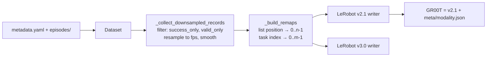
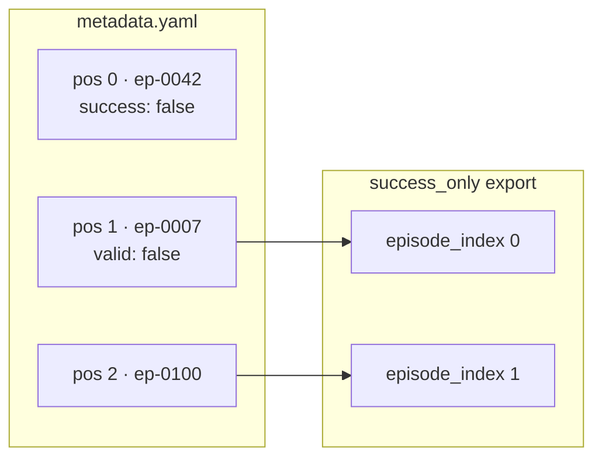

# What Gets Lost When Robot Demonstrations Become Training Data? A Provenance Study of OpenArm Dataset Exports

*An engineering investigation of
[enactic/openarm_dataset#71](https://github.com/enactic/openarm_dataset/issues/71),
carried out on revision `3d291fe` (2026-11-04). Every number below comes
from scripts and tests in `research/` on branch
`research/openarm-dataset-provenance`. No physical OpenArm hardware was
used. All experiments run on the repository's recorded test fixtures.*

## 1. Why robot dataset provenance matters

A robot learning dataset is made of **episodes**. An episode is one
continuous demonstration of a task, for example one teleoperated attempt at
picking up a cube, from start to stop. Each episode is a time series of:

- **observations**: what the robot sensed at each step. For OpenArm, joint
  positions (and optionally velocities and torques) of both arms, the
  lifter elevation, and frames from several cameras.
- **actions**: what the robot was commanded to do at each step. For a
  teleoperated OpenArm, that is the leader device's target joint positions.

A policy is trained to map observations to actions. The training framework
needs only those tensors, a task label and the frame timing. Whatever else
was recorded is optional from its point of view.

From an engineering point of view it is not optional. A demonstration is a
physical event: a particular arm, with particular firmware, driven by a
particular leader device, filmed by particular cameras, at particular
sensor rates. Two demonstrations whose tensors have the same shape can come
from hardware that behaves differently: a different gripper revision, a
re-flashed leader, a camera remounted after maintenance. When a trained
policy misbehaves, or a merged dataset produces a worse model than its
parts, the first question is which recordings, from which setup, went in.
Answering it needs **provenance**: a record of origin that survives every
transformation between the recording and the training run.

Three ideas are worth keeping apart:

- **Provenance**: where data came from and what was done to it.
- **Integrity**: whether the bytes are what they are claimed to be.
  Usually established with hashes or signatures.
- **Model evaluation**: whether a policy trained on the data works.

This study is about the first. Provenance does not prove integrity, and
neither says anything about policy quality. Metadata alone cannot tell you
that a recording is good, only which recording it is.

## 2. The OpenArm recording and export architecture

An OpenArm dataset (format 0.4.0) is a directory:

```
<root>/
  metadata.yaml                      # who, where, what hardware, which episodes
  episodes/<id>/
    obs/arms/<side>/state.parquet    # timestamped qpos / qvel / qtorque / pose
    action/arms/<side>/state.parquet
    obs/lifter/elevation.parquet
    cameras/<name>/<timestamp>.jpeg  # or <name>.tar
```

`metadata.yaml` is rich. Besides the task list and per-episode `success`
and `valid` flags, it records the operator, the location, the operation
type (teleoperation or otherwise), and an `equipment` tree: the equipment
id and version, each embodiment with its id and version (and, for the cell
lifter, its stroke, lead and home position), each camera, and, since
format 0.4.0, the teleoperation leader devices with firmware and hardware
versions. It also records the native rate of every stream (250 Hz arms,
about 30 Hz cameras in the fixtures).

`openarm-dataset-convert` turns this into training formats. The three
studied here:



Every episode is resampled onto a uniform grid at the export `fps`
(default 30), after an optional low-pass filter. Episodes can be filtered
by success and by the validator's `valid` flag. The survivors are
renumbered to be contiguous because LeRobot requires `episode_index` to
run from 0 to n-1.

## 3. Differences between OpenArm, LeRobot and GR00T metadata

| concept | OpenArm | LeRobot v2.1 | LeRobot v3.0 | GR00T |
|---|---|---|---|---|
| dataset description | `metadata.yaml` | `meta/info.json` | `meta/info.json` | v2.1 + `meta/modality.json` |
| episode list | `episodes[]` with string `id` | `meta/episodes.jsonl` | `meta/episodes/chunk-*/file-*.parquet` | v2.1 |
| episode identity | directory name `id` | integer `episode_index`, contiguous | same | same |
| tasks | `prompt` + `description` | `meta/tasks.jsonl` (prompt only) | `meta/tasks.parquet` | v2.1, annotation `task_index` |
| hardware | `equipment` tree | `robot_type` string | `robot_type` string | none beyond v2.1 |
| stream rates | per stream | one `fps` | one `fps` | one `fps` |

LeRobot's schema describes tensors well and hardware barely: one free-text
`robot_type`, which this exporter sets to the constant `"openarm_bimanual"`.
Neither format has a field for a source episode id, a firmware version, or
a record of how the dataset was filtered.

## 4. The original provenance gap

Issue #71 states it plainly: the LeRobot and GR00T writers "only export the
metadata they need to build the tensors", so "an exported dataset is
therefore not traceable back to the recording it came from, and hardware
provenance is lost exactly when it matters (mixing datasets recorded on
different arm/leader versions)".

Reading the code confirms the mechanism. The record that carries an
episode through the conversion is the tuple
`(episode_index, num_frames, obs, actions, cameras)`, and `episode_index`
there is the **position in the metadata list**, not the episode's `id`.
The `id` is read once, to find the episode's files on disk, and never
written. After `_build_remaps`, every writer sees only the renumbered
index.

## 5. Experimental methodology

Everything uses the real exporters on the repository's fixtures. The
fixture episodes are short (two or three frames at 30 Hz) but real
recordings with real camera frames.

1. **Field survey** (`research/scripts/survey_exports.py`). Build a
   representative 0.4.0 dataset from the `dataset_0.4.0_qpos` fixture with
   distinctive values: episode ids `ep-0042`, `ep-0007`, `ep-0100` (not
   contiguous, not sorted), an equipment id, a leader firmware version, a
   task description, an operator, a location, and an unknown custom field.
   Mark `ep-0042` unsuccessful and `ep-0007` invalid. Export to all three
   formats with no filter, `success_only` and `valid_only`. Search every
   file under `meta/`, plus the data parquet schema, for each source
   string.
2. **Loader tolerance probe** (`research/scripts/probe_loader_tolerance.py`).
   Apply one candidate metadata extension at a time to a real export and
   check whether LeRobot still loads it and reads a frame.
3. **Regression tests** (`tests/test_provenance.py`, 78 cases), written
   and run before the fix.
4. **Cross-revision comparison** (`research/scripts/compare_exports.py`).
   Export the same source with the upstream code and with the change, and
   compare every output file by SHA-256.

Environments: Windows 11 with lerobot 0.3.3 (the version the
`lerobot-dataset-v2.1` extra pins) for v2.1 and GR00T; WSL2 Ubuntu with
lerobot 0.7.0 for v3.0, because the v3.0 writer cannot run on Windows (it
reopens a `NamedTemporaryFile` by name, a pre-existing limitation).

## 6. Verified baseline findings

On upstream code, in all three formats and under all three selections, the
only source string that survives is the task prompt
(`research/evidence/survey_baseline.md`). Lost: every episode id, the
equipment id and version, every embodiment id and the lifter geometry, the
leader device id and firmware, the operation type, the task description,
operator, location and the custom field. Numeric fields not searched by
string (format version, stream rates) are also absent: the rates are
replaced by the single export `fps`.

The sharpest finding concerns filtering. The `success_only` export
contains source positions 1 and 2 (`ep-0007`, `ep-0100`). The
`valid_only` export contains positions 0 and 2 (`ep-0042`, `ep-0100`).
Both exports have two episodes of two frames each, with the same task.
Their `episodes.jsonl` files are identical:

```
{"episode_index": 0, "tasks": ["Pick the cube."], "length": 2}
{"episode_index": 1, "tasks": ["Pick the cube."], "length": 2}
```

Exported episode 0 is a different physical demonstration in each, and the
metadata of neither export says so. Both still load in LeRobot. This is
what "a valid tensor dataset with incomplete provenance" means in
practice: nothing is malformed, the model trains, and the question "which
recording is this?" has no answer.

## 7. Design alternatives

The loader probe decided most of the design
(`research/evidence/loader_tolerance.md`):

| extension | lerobot 0.3.3 (v2.1) | lerobot 0.7.0 (v3.0) |
|---|---|---|
| extra key in `info.json` | loads, visible | loads, **silently dropped** |
| extra per-episode field | loads, visible | loads, visible |
| extra data parquet column | loads | **fails to load** |
| separate `meta/openarm.json` | loads | loads |

So per-frame columns are out (they break the v3.0 loader, and they would
change the training files). An `info.json` extension is out as well:
lerobot 0.7.0 parses `info.json` into a typed structure and discards what
it does not know, so the provenance would disappear the first time the
dataset is re-saved through LeRobot. A per-episode field survives in both
versions, but dataset-level identity has no per-episode home.

The chosen design is a versioned sidecar, `meta/openarm.json`, with one
schema for all three formats, written by one shared helper. It changes no
existing file. The alternatives, including a sidecar plus a native
per-episode source id and a GR00T annotation channel for the hardware
version, are compared in `research/PROVENANCE_DESIGN.md`. The granularity follows from the data model. One OpenArm dataset has one
`equipment` block, and `openarm-dataset-merge` refuses to merge datasets
whose equipment differs, so within any single export the hardware identity
is constant. A per-frame or per-episode hardware annotation would carry no
information inside one export. Hardware only varies *between* exports, so
it belongs in a dataset-level record that a training pipeline mixing
several exports can read. The sidecar is
not a novel idea. It is the conventional answer when a destination schema
has no extension point, and another applicant proposed the same filename
on the issue a month earlier. The engineering content is in what goes
into it and what is kept out.

## 8. Implementation

The change touches four source files: a new
`src/openarm_dataset/provenance.py` (about 250 lines including
docstrings), plus 20 to 30 added lines each in `lerobot_v21.py` and
`lerobot_v30.py` and a flag in `convert.py`. Inside each exporter:

```python
remap_episode_index, remap_task_index = _build_remaps(dataset, records)
provenance = build_provenance(           # before anything is written
    dataset, [pos for pos, *_ in records],
    remap_episode_index, remap_task_index,
    {"fps": fps, "smoothing_cutoff": smoothing_cutoff, "state": state,
     "arm_dynamics": arm_dynamics, "success_only": success_only,
     "valid_only": valid_only},
    include_sensitive_metadata,
)
...                                      # existing writers, unchanged
write_provenance(output_dir, provenance) # last
```

GR00T needs no code of its own: `to_gr00t` already calls `to_lerobotv21`
and only passes the new option through.

Two ordering decisions matter. The record is built after the episodes are
sampled but before any file is written, so metadata that cannot be
represented in JSON (a YAML binary blob, a NaN) fails the conversion
without leaving partial output. And it is written last, so a conversion
that fails part-way never leaves a provenance file claiming a complete
export.

## 9. Source-to-export episode mapping



Each exported episode is recorded as:

```json
{"episode_index": 0, "task_index": 0,
 "source": {"index": 1, "id": "ep-0007", "success": true,
            "task_index": 0, "valid": false}}
```

`source.index` (the position in `metadata.yaml`) is stored as well as
`source.id` because ids are not guaranteed unique: two metadata entries
can name the same episode directory, and the test suite covers that case.
The exported `task_index` and the source `task_index` are both stored
because tasks are renumbered too.

The walkthrough in `research/evidence/cli_walkthrough_gr00t.txt` shows
something the mapping makes visible. `--success-only` exported `ep-0007`,
an episode the validator had marked `valid: false`, because only
`--valid-only` excludes invalid episodes. Before this change, nothing in
the training dataset recorded that an invalid-flagged recording was in it.

Filtered-out episodes are not listed, by id or otherwise. Their count
follows from `source.num_episodes` minus the number listed, and
`conversion` records which filters ran.

## 10. Handling hardware metadata and privacy

Hardware identity is the point of the issue. The `equipment` tree is
copied whole, as the package reads it: unversioned datasets are normalised
the same way the export itself is built, and nothing missing is filled in.
`Metadata.operation_type` returns `"teleop"` when the field is absent, so
the sidecar reads the raw field instead. A 0.1.0 dataset, which predates
`operation_type`, gets no `operation_type` in its sidecar.

`operator` names a person and `location` can name a site. LeRobot datasets
are routinely pushed to public hubs, and the sidecar travels with them, so
both fields are withheld unless the caller passes
`include_sensitive_metadata=True` (`--include-sensitive-metadata`). Fields
the package does not recognise are withheld even then, because nothing
says whether they are sensitive. Every withheld field is listed by name in
`withheld`, so "not recorded" and "recorded but not exported" can be told
apart.

Two honest caveats. First, `equipment` is copied verbatim, so a lab that
stores serial numbers there exports them. Allowlisting nested hardware
keys would silently drop new hardware fields, which is the failure this
change exists to fix. Second, the project's own `openarm-dataset-upload`
already publishes `metadata.yaml`, operator and location included, on the
dataset card. The privacy default here is a proposal for maintainers to
accept or flip, not a settled policy.

A hash of `metadata.yaml` was considered and left out. It does not cover
the episode data, so it says nothing about integrity. It changes whenever
the validator writes `valid` flags. And with operator and location
withheld, a hash over the full metadata would let anyone with a short list
of candidate names test them, because every other hashed field is
published in the same file.

## 11. Before and after

Regression tests, `tests/test_provenance.py`:

| run | before the change | after |
|---|---|---|
| v2.1 + GR00T cases, Windows, lerobot 0.3.3 | 52 failed, 8 passed | 60 passed |
| v3.0 cases, Linux, lerobot 0.7.0 | 15 failed, 3 passed | all pass |

The cases that pass before the change are guards: a failed conversion
writes no sidecar, and the CLI rejects the new flag for formats it does
not apply to. Upstream code passes both trivially.

Whole suite after the change: Linux (the CI platform), **368 passed, 7
skipped**. The skips are optional extras not installed (lz4, rerun), the
v2.1 loader under lerobot ≥ 0.5, and one test that needs `ffprobe`. On
Windows the upstream failures are unchanged, and the new v3.0 cases fail
there for the same pre-existing temp-file reason as upstream's own v3.0
tests.

Field survey after the change (`research/evidence/survey_after.md`):
every episode id of each export's episodes, the equipment id and version,
the embodiment and leader details, the operation type and the task
description are in `meta/openarm.json` in all three formats. Operator,
location and the custom field remain absent by default, as designed.

## 12. Compatibility implications

`research/evidence/compare_exports.md` exports the same source with the
upstream code and with the change, in all three formats under four
selections, and compares every file by SHA-256: data parquet, MP4 videos,
`info.json`, episode tables, stats, tasks and `modality.json`. All are
byte-identical. The only difference is the added `meta/openarm.json`.
LeRobot 0.3.3 loads the v2.1 and GR00T exports and LeRobot 0.7.0 loads the
v3.0 export, with the sidecar present, and the loaded episode count
matches the sidecar's.

The public API gains one keyword argument, `include_sensitive_metadata`,
defaulting to `False`, on the three writer functions, and one CLI flag.
Nothing else changes signature.

## 13. Limitations

- **No hardware.** Fixtures only. The study says nothing about real
  multi-rig corpora beyond what the fixtures exercise.
- **Isaac-GR00T's loader was not run.** GR00T compatibility rests on the
  GR00T export being a LeRobot v2.1 dataset with an untouched
  `modality.json`. It loads in LeRobot 0.3.3, but GR00T's own reader was
  not installed.
- **Merge already loses provenance.** `openarm-dataset-merge` renumbers
  episode ids and records nothing about which input an episode came from.
  An export of a merged dataset can only trace back to the merged dataset.
- **The sidecar is not tamper-evident** and can be detached. It is a
  record, not a proof.
- **No training use yet.** The issue also says "some of the information
  can be used in training". Making equipment or leader version available
  to a policy, for example as a GR00T annotation channel, is a separate
  design decision for the maintainers and is not attempted here.
- **`robot_eval_logger` and `rrd` exports are out of scope.**

## 14. Future research directions

- Carry provenance through `merge` (an input-dataset table and original
  ids) so exports of merged corpora remain traceable.
- An export verifier: given an export and its source, re-sample each
  mapped episode and confirm it matches, turning the provenance record
  into something checkable.
- Optional content hashes of episode data, as a separate integrity
  feature with its own cost analysis.
- Hardware-conditioned training on mixed OpenArm corpora, once the
  hardware identity reliably survives export: filtering, stratified
  evaluation by leader or arm version, or a GR00T annotation channel.

## Appendix: reproducing

```bash
git checkout research/openarm-dataset-provenance
uv sync -p 3.12 --extra lerobot-dataset-v2.1     # or lerobot-dataset-v3.0 on Linux
uv run pytest tests/test_provenance.py -rs
uv run python research/scripts/survey_exports.py /tmp/survey lerobot_v2.1 gr00t
```

An adjacent defect, outside #71, turned up during the audit: v2.1 and
GR00T exports with `valid_only` crash when the excluded first episode has
a missing camera (`research/scripts/repro_v21_first_episode.py`).
